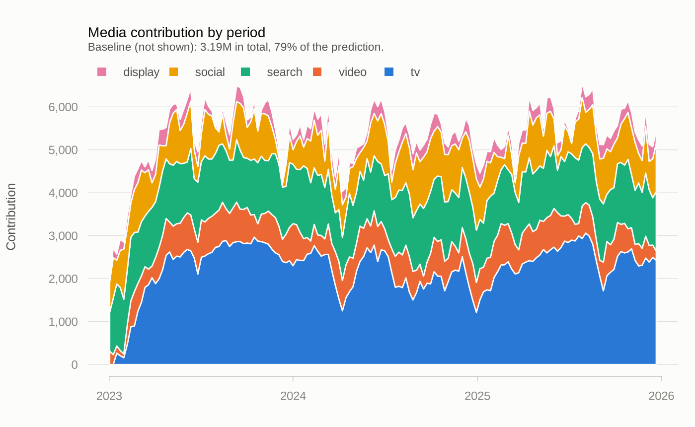
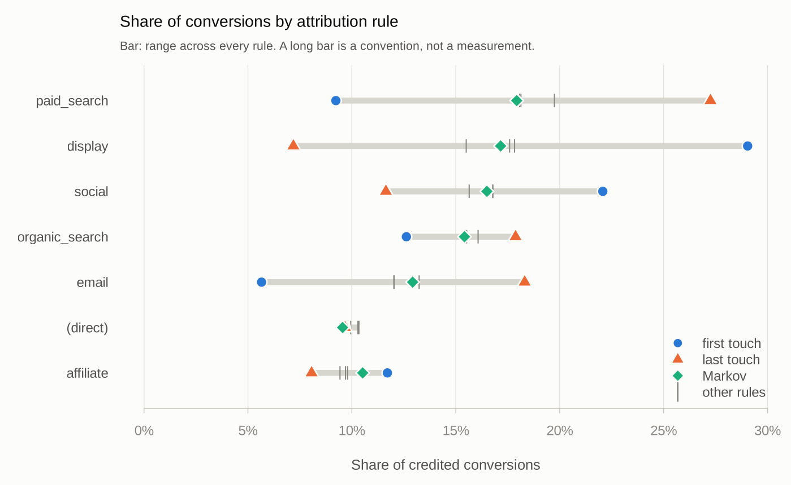

<!-- README.md is knitted from README.Rmd. Edit README.Rmd, then run
devtools::build_readme() to rebuild README.md and its figures. -->

# mediamix

<!-- badges: start -->

[](https://github.com/elkronos/mediamix/actions/workflows/R-CMD-check.yaml)
[](https://lifecycle.r-lib.org/articles/stages.html#experimental)
<!-- badges: end -->

Composable media transforms and attribution path construction for R.

mediamix turns raw marketing data into model-ready features: media spend
into carryover- and saturation-adjusted regressors, and raw event logs
into attributed customer journeys.

Use it if you fit your own marketing mix model, whether in `lm()`,
`glmnet`, `brms`, Stan or a tidymodels workflow, or if you need customer
journeys and attribution built from a raw event log.

It is a preprocessing, feature-engineering and reporting package, not a
modelling engine. `lm()`, `glmnet` and `brms` fit models better than a
marketing package would, and `tune` does hyperparameter search properly.
mediamix does the steps in front of the model and the decomposition
after it, with the methodological details that usually get skipped
written into the API.

Documentation, walkthroughs and worked examples are on the package
website, <https://elkronos.github.io/mediamix/>.

## What it offers

The full MMM frameworks (Robyn in R; Meridian and PyMC-Marketing in
Python) bundle transforms, a model, an optimiser and reporting into one
pipeline. mediamix provides those pieces separately, for use around a
model you choose:

- `step_adstock()` carries filter state across the train/test boundary,
  so carryover, saturation and a model penalty can be tuned jointly in
  one `tune_bayes()` call with no rows lost.
- `marginal_roi()` re-runs the whole transform on a 1% larger budget,
  the definition used by Jin et al. (2017) and by Meridian. The common
  shortcut, a curve’s slope times the kernel’s first weight, understates
  slow channels several-fold.
- `tune_carryover()` and, for every channel at once inside one model
  with controls, `tune_carryover_joint()` score candidates on held-out
  KPI with forward-only resampling and report the one-standard-error
  choice alongside the minimum.
- `block_bootstrap()` resamples runs of weeks to put intervals on ROI,
  marginal ROI or anything else you compute.
- `build_paths()` turns a raw event log into journeys with every
  construction choice an argument, and accounts for the conversions that
  filtering leaves unattributable.
- `attribute()` runs five rule-based credit schemes and an order-1
  Markov removal-effect model side by side, and `attribution_spread()`
  reports how much the answer depends on the choice.
- `decay_from_half_life()` and `half_life()` translate between a decay
  coefficient and the half-life practitioners talk in, and
  `effective_window()` gives the number of periods that hold 90% of the
  effect; both halves of the package use this one vocabulary.

## Scope

| In                                                   | Out                            | Because                               |
|------------------------------------------------------|--------------------------------|---------------------------------------|
| Adstock and saturation transforms                    | Model fitting                  | `lm`, `glmnet`, `brms` already exist  |
| Carryover selection by cross-validation              | Bespoke optimisers             | `tune` does this properly             |
| Journey construction from event logs                 | Higher-order Markov chains     | `ChannelAttribution` does them in C++ |
| Rule-based credit and order-1 Markov removal effects | Causal incrementality          | Requires experiments, not logs        |
| Contribution, ROI and counterfactual marginal ROI    | Budget optimisation            | Deserves its own design pass          |
| Media data diagnostics                               | Generic regression diagnostics | `broom`, `performance`                |

`as_channel_paths()` exports journeys straight into
`ChannelAttribution`’s format, for higher-order models and very large
path tables.

## Installation

mediamix is not yet on CRAN. Install the development version from
GitHub:

``` r
# install.packages("pak")
pak::pak("elkronos/mediamix")
```

`pak` does not build vignettes for packages installed from GitHub, so
`vignette("carryover")` and the others are not available after this
install. Read them on the [package
website](https://elkronos.github.io/mediamix/), or install with
`remotes::install_github("elkronos/mediamix", build_vignettes = TRUE)`.

mediamix imports `cli` and `rlang` for its messages and `data.table` for
the attribution half, where event logs get large. It has no compiled
code. `recipes`, `dials` and the rest of tidymodels are in `Suggests`
and registered conditionally, so the transforms work equally well from a
Stan or `brms` workflow that will never touch them.

## Example

### Media mix modelling

`mm_weekly` holds three years of weekly spend on five channels, with
price and revenue, for three geographies. It was simulated from known
carryover and saturation parameters, kept in its `"truth"` attribute, so
every estimate below can be checked. The example uses the north
geography:

``` r
library(mediamix)
data(mm_weekly)
truth <- attr(mm_weekly, "truth")

north <- mm_weekly[mm_weekly$geo == "north", ]
channels <- c("tv", "video", "search", "social", "display")
controls <- data.frame(week = seq_len(nrow(north)), price = north$price,
                       seasonality = north$seasonality,
                       holiday = north$holiday)
```

It is tempting to choose decay by asking which transformed series is
best-behaved. That criterion has no dependent variable in it, so it
ranks filters by how hard they smooth rather than by anything about the
outcome. `tune_carryover_joint()` scores each candidate by how well a
model with every channel and the controls predicts *held-out* revenue,
so no channel is credited with another’s effect. The default model is
ordinary least squares; `fit_fn` and `predict_fn` take any other.

``` r
joint <- tune_carryover_joint(north[channels], north$revenue,
                              controls = controls)
rbind(estimate = joint$best$decay, truth = truth$decay[channels])
#>            tv video search social display
#> estimate 0.80   0.5   0.65   0.55    0.60
#> truth    0.85   0.7   0.15   0.45    0.55
```

Of the five, video and search miss by more than 0.1. Search’s
cross-validation profile is almost flat: the data does not identify its
carryover, which `plot(joint)` makes visible and a bare point estimate
would hide. Carryover is weakly identified in most real data, which is
why the one-standard-error rule (Hastie, Tibshirani and Friedman, 2009)
is reported alongside, as `joint$best_1se`.

The joint search does not tune saturation, so to keep the example short
the model below uses the parameters `mm_weekly` was simulated from:
geometric adstock (Broadbent, 1979) followed by a Hill curve (Hill,
1910), which `media_transform()` applies in that order. Any model can go
on top; here it is `lm()` with the controls. `contributions()` splits
the fitted revenue into one part per channel and a baseline, and `roi()`
divides each channel’s contribution by its spend:

``` r
one_channel <- function(ch) {
  media_transform(north[[ch]],
                  adstock = list(decay = truth$decay[[ch]]),
                  saturation = list(half_max = truth$half_max[[ch]],
                                    shape = truth$shape[[ch]]))
}
media <- as.data.frame(sapply(channels, one_channel))
fit <- lm(north$revenue ~ ., data = cbind(media, controls))
contrib <- contributions(media, fit, index = north$date)
roi(contrib, north[channels])
#>   channel contribution  spend   roi
#> 1  social       132709  36716 3.614
#> 2  search       208307  74560 2.794
#> 3   video       102461  53248 1.924
#> 4 display        40853  26937 1.517
#> 5      tv       349629 266978 1.310
```

Every channel returns more than it costs on average. The main results
have `plot()` methods in one consistent, colour-vision-checked style;
here is the decomposition week by week:

``` r
plot(contrib)
```



Average ROI is a scorecard; marginal ROI is the decision variable.
`marginal_roi()` computes it the way Jin et al. (2017) and Meridian
define it, as the extra response from a 1% larger budget divided by the
extra spend, by re-running carryover and saturation rather than
differentiating a curve:

``` r
tv <- marginal_roi(north$tv, coefficient = coef(fit)[["tv"]],
                   adstock = list(decay = truth$decay[["tv"]]),
                   saturation = list(half_max = truth$half_max[["tv"]],
                                     shape = truth$shape[["tv"]]))
tv
#>    spend contribution  roi  mroi
#> 1 266978       349629 1.31 1.253
```

Television’s next pound returns 1.25, close to its average of 1.31. The
tempting shortcut, the curve’s slope times the kernel’s first weight,
gives 0.21 for this channel: it counts only the week of spend and
discards the 85% of the effect that arrives later.

`block_bootstrap()` puts intervals on any of these numbers. On
`mm_weekly` they are wide, which is the point: see the [budget
walkthrough](https://elkronos.github.io/mediamix/articles/budget-walkthrough.html)
for how that changes a recommendation, and how its answer compares with
the truth the data was simulated from.

### Attribution

Attribution tools such as `ChannelAttribution` consume `"a > b > c"`
strings with conversion counts attached; producing those strings is left
to the analyst. That step usually ends up as a `group_by()` and a
`paste(collapse = " > ")`, and that loses a great deal.

On `mm_events`, the package’s 20,799-event synthetic log:

|                                    | journeys | mean length |
|:-----------------------------------|---------:|------------:|
| naive one-path-per-customer        |    5,400 |        3.85 |
| split on conversion                |    6,105 |        3.39 |
| \+ 30-day inactivity gap           |    6,105 |        3.39 |
| \+ collapse consecutive duplicates |    6,105 |        2.83 |

The last row has 13% more journeys than the first, and they are 27%
shorter. Journey counts and lengths feed a Markov transition matrix
directly, so those are not rounding differences. Each of these choices
is an argument to `build_paths()`:

``` r
paths <- build_paths(
  mm_events,
  id = "customer_id", channel = "channel", timestamp = "timestamp",
  conversion = "conversion", value = "value",
  lookback = 30,                       # or read it off conversion_lag()
  split_on = c("conversion", "gap"), gap = 30,
  collapse_repeats = TRUE,
  keep_null_paths = TRUE,              # Markov removal effects need these
  direct = "label"
)
```

`build_paths()` handles the things that go wrong between an event log
and a set of journeys: journey splitting, lookback windows,
non-converting paths, direct, none and missing channels, consecutive
duplicates, duplicate events, timestamps that do not parse,
deterministic tie-breaking, and accounting for conversions that
filtering leaves unattributable. Each is an argument, not an assumption.

Dropping direct traffic can strip a converting journey of every
touchpoint it had. mediamix fixes the conversion facts before any
filtering, so those conversions are counted and reported as
`conversions_unattributable` rather than quietly shrinking the
denominator.

Any single credit rule gives you a number. Several give you the range
that number could have been. `attribute()` runs five heuristic rules and
an order-1 Markov removal-effect model (Anderl et al., 2016). The four
channels whose share varies most:

``` r
shares <- attribute(paths)
spread <- attribution_spread(shares)
head(spread, 4)
#>       channel min_share max_share mean_share spread first_last_ratio
#> 1     display   0.07187    0.2904     0.1739 0.2185           4.0406
#> 2 paid_search   0.09230    0.2725     0.1840 0.1802           0.3387
#> 3       email   0.05655    0.1831     0.1237 0.1266           0.3088
#> 4      social   0.11638    0.2207     0.1657 0.1043           1.8966
```

``` r
plot(shares)
```



Display’s share runs from 7% to 29% depending only on the convention
chosen. That channel has not been measured; it has been assigned a
number. The Markov share falls inside the heuristic range for 6 of 7
channels here: a data-driven convention narrows the argument without
ending it.

Rule-based attribution is a bookkeeping convention, not a causal
estimate. It divides observed conversions among observed touchpoints by
a rule you chose; it cannot tell you what would have happened if a
channel had not run, because that outcome is not in the log. Only an
experiment answers that.

## Where to go next

From first steps to deeper material:

- `vignette("mediamix")`: getting started, from raw data to
  contributions and ROI.
- The [budget
  walkthrough](https://elkronos.github.io/mediamix/articles/budget-walkthrough.html):
  one budget question from weekly spend to a recommendation, checked
  against the parameters the data was simulated from.
- `vignette("carryover")`: choosing decay and lag by cross-validation,
  and why five correlated channels make it harder.
- `vignette("tidymodels")`: joint tuning of transform and model
  parameters, with recipe steps that carry adstock across the train/test
  boundary.
- `vignette("journeys")`: building journeys from event logs.
- `vignette("spine")`: carryover and credit are the same idea, the
  geometric kernel run forward from spend for adstock and backward from
  a conversion for time-decay credit.
- [Methods and
  references](https://elkronos.github.io/mediamix/articles/methodology.html):
  the method behind each function and where it comes from.
- [How mediamix relates to other
  tools](https://elkronos.github.io/mediamix/articles/comparison.html):
  Robyn, Meridian, PyMC-Marketing and ChannelAttribution.

The walkthrough, the methods page and the comparison are on the website
only; the vignettes also ship with the package.

## References

Anderl, E., Becker, I., von Wangenheim, F. and Schumann, J. H. (2016).
Mapping the customer journey: Lessons learned from graph-based online
attribution modeling. *International Journal of Research in Marketing*,
33(3), 457–474.

Broadbent, S. (1979). One way TV advertisements work. *Journal of the
Market Research Society*, 21(3), 139–166.

Hastie, T., Tibshirani, R. and Friedman, J. (2009). *The Elements of
Statistical Learning* (2nd ed.). Springer.

Hill, A. V. (1910). The possible effects of the aggregation of the
molecules of haemoglobin on its dissociation curves. *The Journal of
Physiology*, 40, iv–vii.

Jin, Y., Wang, Y., Sun, Y., Chan, D. and Koehler, J. (2017). *Bayesian
methods for media mix modeling with carryover and shape effects.* Google
Inc.
