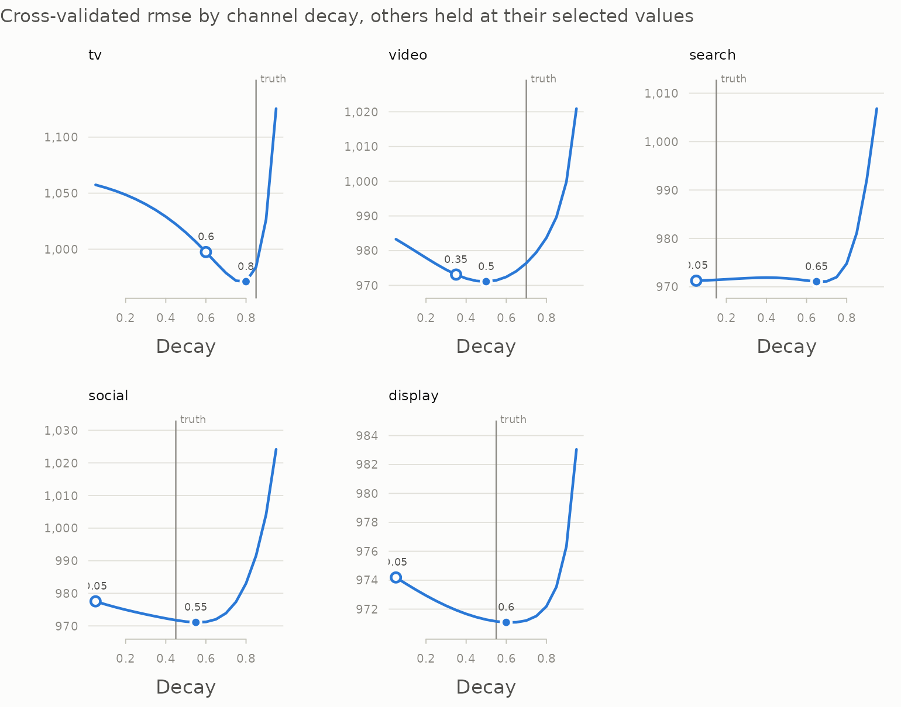
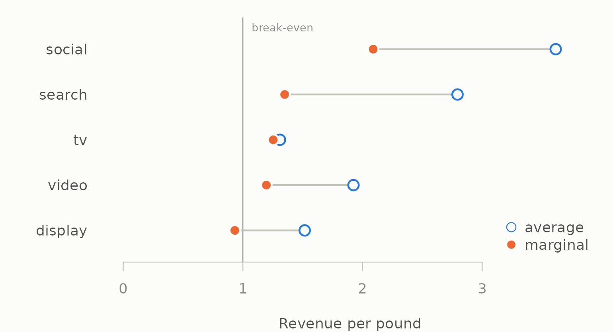
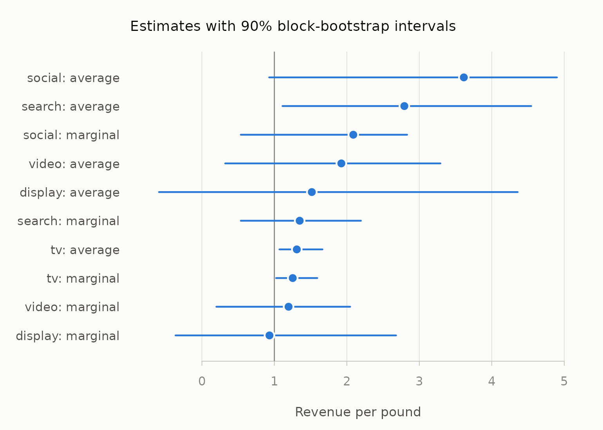
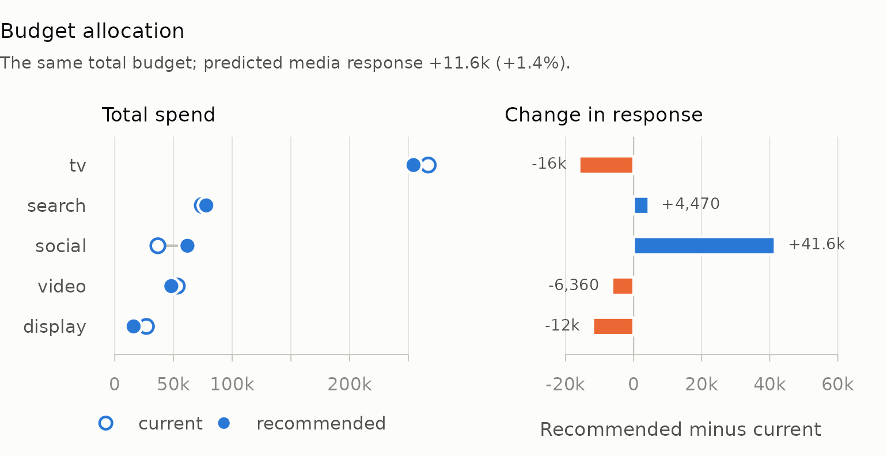

# Walkthrough: from weekly spend to a budget recommendation

This article follows one question from raw data to an answer: if the
marketing budget stays the same, should any of it move between channels?
It uses the north geography of `mm_weekly`, 156 weeks of five channels,
generated from known parameters so that every step can be checked
against the truth.

The getting-started vignette,
[`vignette("mediamix")`](https://elkronos.github.io/mediamix/articles/mediamix.md),
introduces each function. This article is about using them together, and
about where the answer is solid and where it is not.

The setup keeps the parameters `mm_weekly` was generated from in
`truth`, and adds a week counter to serve as the trend control:

``` r

library(mediamix)
data(mm_weekly)

channels <- c("tv", "video", "search", "social", "display")
truth <- attr(mm_weekly, "truth")
north <- mm_weekly[mm_weekly$geo == "north", ]
north <- north[order(north$date), ]
north$week <- seq_len(nrow(north))
```

## 1. Check the data can answer the question

A model can only tell channels apart if they move independently of one
another and vary from week to week.
[`diagnose_media()`](https://elkronos.github.io/mediamix/reference/diagnose_media.md)
checks both before anything is fitted:

``` r

d <- diagnose_media(north, media = channels, decay = 0.6)
d
#> 
#> ── Media diagnostics
#> 156 observations across 1 series, 5 channels
#> Collinearity measured on adstocked media.
#> Ungrouped. On panel data, pass `by` so that collinearity is measured within
#> series.
#> ✔ No structural problems found.
#> 
#> Inspect $variation, $collinearity, $correlations.
d$collinearity[, c("channel", "vif", "most_correlated_with", "correlation")]
#>   channel   vif most_correlated_with correlation
#> 1  search 1.188                   tv      0.3173
#> 2      tv 1.176               search      0.3173
#> 3  social 1.169              display      0.2801
#> 4 display 1.148               social      0.2801
#> 5   video 1.076              display      0.1451
```

`decay = 0.6` measures collinearity after a representative adstock,
since smoothed series correlate more than raw spend and the model sees
the smoothed ones. No channel is collinear enough to make its
coefficient meaningless: the largest variance inflation factor (`vif`)
is 1.19, well under
[`diagnose_media()`](https://elkronos.github.io/mediamix/reference/diagnose_media.md)’s
default warning level of 5. Every channel varies, but video and display
are dark, with no spend at all, in 37% and 33% of weeks, so they carry
less information than their row count suggests, which is worth
remembering when their numbers come out.

## 2. Carryover: how well does the data identify it?

Tune every channel’s carryover at once, in one model that also holds the
controls, so no channel is credited with another’s effect or with the
trend:

``` r

controls <- north[c("week", "price", "seasonality", "holiday")]
grid <- seq(0.05, 0.95, by = 0.05)

joint <- tune_carryover_joint(north[channels], north$revenue,
                              controls = controls, decays = grid)
rbind(truth  = truth$decay[channels],
      best   = joint$best$decay,
      one_se = joint$best_1se$decay)
#>          tv video search social display
#> truth  0.85  0.70   0.15   0.45    0.55
#> best   0.80  0.50   0.65   0.55    0.60
#> one_se 0.60  0.35   0.05   0.05    0.05
```

`best` is the minimum of each channel’s cross-validation curve, and
`one_se` the shortest carryover within one standard error of it. The
curves themselves show how firmly the data pins each decay down:

``` r

plot(joint, truth = truth$decay)
```



Television, social and display land within 0.1 of the truth and video
within 0.2. Search does not, and its profile says why: it is nearly
flat, so the data holds almost no information about search’s carryover.
For search the one-standard-error choice falls back to a short
carryover, which here is close to right; for every other channel it is
shorter than the truth.

The joint search does not tune saturation. To keep this walkthrough
about the *decision* rather than the estimation, the rest of it uses the
generating parameters, which is what a full joint search over carryover
*and* saturation, as in
[`vignette("tidymodels")`](https://elkronos.github.io/mediamix/articles/tidymodels.md),
is trying to reach. Section 7 comes back to what happens when
television’s carryover is uncertain.

## 3. Fit the model

The model is ordinary least squares on the transformed media and the
controls. `spec` holds each channel’s carryover and saturation.
[`transform_plan()`](https://elkronos.github.io/mediamix/reference/transform_plan.md)
applies them to any spend plan and returns the plan with each channel’s
column transformed, so section 7 can reuse `spec` on budgets that were
never run:

``` r

spec <- lapply(channels, function(ch) list(
  adstock = list(decay = truth$decay[[ch]]),
  saturation = list(half_max = truth$half_max[[ch]],
                    shape = truth$shape[[ch]])
))
names(spec) <- channels

media <- transform_plan(north, spec)[channels]
model_data <- cbind(media, controls)
fit <- lm(north$revenue ~ ., data = model_data)
round(rbind(estimate = coef(fit)[channels], truth = truth$beta[channels]))
#>            tv video search social display
#> estimate 6013  1885   2622   2258     760
#> truth    5200  2400   4100   1800     900
```

Even with the transforms right, the coefficients land well away from the
truth: search’s is 36% too low and social’s 25% too high. That is three
years of weekly noise, and section 8 shows what it does to the answer.

## 4. Where did the revenue come from?

[`contributions()`](https://elkronos.github.io/mediamix/reference/contributions.md)
splits each week’s fitted revenue into one part per channel and a
baseline, and
[`roi()`](https://elkronos.github.io/mediamix/reference/roi.md) divides
each channel’s total contribution by its total spend to give its average
return:

``` r

contrib <- contributions(media, fit, index = north$date)
avg <- roi(contrib, north[channels])
avg
#>   channel contribution  spend   roi
#> 1  social       132709  36716 3.614
#> 2  search       208307  74560 2.794
#> 3   video       102461  53248 1.924
#> 4 display        40853  26937 1.517
#> 5      tv       349629 266978 1.310
```

Every channel returns more than it costs on average. On this table alone
the tempting move is to take money from television, the lowest average
ROI, and give it to social, the highest.

## 5. What would the next pound do?

Average ROI describes the budget that was spent. The reallocation
question is about the *margin*, and
[`marginal_roi()`](https://elkronos.github.io/mediamix/reference/marginal_roi.md)
answers it by re-running the whole transform on a slightly larger
budget. Given the plan, the coefficients and `spec`, it does every
channel at once, and its `roi` column is the average return from section
4:

``` r

marginal <- marginal_roi(north, coef(fit), spec = spec)
marginal[order(-marginal$mroi), c("channel", "mroi", "roi", "spend")]
#>   channel   mroi   roi  spend
#> 4  social 2.0892 3.614  36716
#> 3  search 1.3490 2.794  74560
#> 1      tv 1.2534 1.310 266978
#> 2   video 1.1961 1.924  53248
#> 5 display 0.9324 1.517  26937
```

The ranking changes. Social still has the highest marginal return, but
television is no longer at the bottom: its S-shaped response means its
next pound works nearly as hard as its average one. Display is now last,
and its estimated marginal return is below 1: in this model, the last
pounds spent on it did not pay for themselves.

The chart sets each channel’s average return (open circle) beside its
marginal return (filled circle); the vertical line is break-even:



So in this model the candidate move is *display to social*, not
*television to social*.

## 6. How sure are we?

Every number so far is a point estimate from one sample of 156 weeks. A
block bootstrap resamples runs of consecutive weeks, refits the model,
and recomputes, which shows how much of the ranking survives sampling
noise. The transform is not re-run on the resampled rows, because that
would glue unrelated weeks together and carry spend across the joins.
Each replicate refits the coefficients on resampled rows and recomputes
average and marginal return on the original spend plan:

``` r

boot_data <- cbind(revenue = north$revenue, media, controls)

returns <- function(d) {
  f <- lm(revenue ~ ., data = d)
  r <- marginal_roi(north, coef(f), spec = spec)
  out <- c(rbind(r$roi, r$mroi))
  names(out) <- paste(rep(r$channel, each = 2), c("average", "marginal"),
                      sep = ": ")
  out
}

boot <- block_bootstrap(boot_data, returns, times = 200, block_length = 13,
                        seed = 2026)
boot
#> 
#> ── Block bootstrap
#> 200 replicates, blocks of 13 rows, 90% percentile intervals
#>               term estimate   lower upper std_error
#>        tv: average   1.3096  1.0698 1.664    0.1924
#>       tv: marginal   1.2534  1.0240 1.592    0.1842
#>     video: average   1.9242  0.3211 3.291    0.9783
#>    video: marginal   1.1961  0.1996 2.046    0.6081
#>    search: average   2.7938  1.1118 4.545    1.0664
#>   search: marginal   1.3490  0.5368 2.194    0.5149
#>    social: average   3.6145  0.9283 4.900    1.2335
#>   social: marginal   2.0892  0.5365 2.832    0.7130
#>   display: average   1.5166 -0.5923 4.358    1.5145
#>  display: marginal   0.9324 -0.3642 2.679    0.9311
```

``` r

plot(boot, reference = 1, xlab = "Revenue per pound")
```



The intervals are wide. Only the intervals for `tv: average`,
`tv: marginal` and `search: average` lie entirely above break-even;
every other interval crosses 1, and both of display’s reach below zero.
They hold the transforms at the true parameters chosen in section 3, so
they show sampling uncertainty in the coefficients only. Two channels’
intervals overlapping does not settle a comparison between them, because
their estimates move together from replicate to replicate, so ask the
paired question directly:

``` r

reps <- attr(boot, "replicates")
paired <- c(social_beats_display = mean(reps[, "social: marginal"] >
                                          reps[, "display: marginal"]),
            social_beats_tv      = mean(reps[, "social: marginal"] >
                                          reps[, "tv: marginal"]))
paired
#> social_beats_display      social_beats_tv 
#>                 0.72                 0.80
```

Social’s marginal return beats display’s in 72% of replicates and
television’s in 80%. That is the honest strength of the evidence for
moving money into social: more likely right than wrong, and not more
than that. It is a reason to run the move as a test, not to announce it.

## 7. Test the move before recommending it

A marginal return is a derivative. A real reallocation is a finite
change, and the response curves bend along the way, so simulate the new
plan through the model rather than multiplying by a marginal rate.
[`reallocate()`](https://elkronos.github.io/mediamix/reference/reallocate.md)
builds the new plan, keeping each channel’s flighting: it takes the
amount from one channel in proportion to its spend in each week and adds
it to the other in proportion to that channel’s.
[`simulate_plan()`](https://elkronos.github.io/mediamix/reference/simulate_plan.md)
runs a plan through `spec` and the coefficients, and with `baseline` it
adds each channel’s change in spend and in predicted response.
Everything except the two channels is held fixed, and the controls do
not change, so the sum of `response_change` is the difference in
predicted revenue:

``` r

tenth <- 0.10 * sum(north$display)
to_social <- reallocate(north, from = "display", to = "social",
                        amount = tenth)
simulate_plan(to_social, spec, coef(fit), baseline = north)
#>   channel  spend response spend_change response_change
#> 1      tv 266978   349629            0               0
#> 2   video  53248   102461            0               0
#> 3  search  74560   208307            0               0
#> 4  social  39410   138198         2694            5489
#> 5 display  24243    38235        -2694           -2618
```

The same two steps compare several moves, here by the gain per pound
moved:

``` r

move <- function(from, to, amount, spec, coefficients = coef(fit)) {
  plan <- reallocate(north, from = from, to = to, amount = amount)
  change <- simulate_plan(plan, spec, coefficients, baseline = north)
  gain <- sum(change$response_change)
  c(moved = amount, revenue_change = gain, per_pound_moved = gain / amount)
}

rbind(
  `display -> social` = move("display", "social", tenth, spec),
  `tv -> social`      = move("tv", "social", tenth, spec),
  `display -> social, 2.5x` = move("display", "social", 2.5 * tenth, spec)
)
#>                         moved revenue_change per_pound_moved
#> display -> social        2694           2871          1.0659
#> tv -> social             2694           2090          0.7760
#> display -> social, 2.5x  6734           6213          0.9226
```

In the model, moving a tenth of display’s budget into social raises
predicted revenue at no extra cost. Moving the *same amount* out of
television instead, the move the average-ROI table suggested, gains
less, because it gives up television’s still-steep fitted response.
Moving two and a half times as much out of display gains more in total
but less per pound, as social climbs its own curve.

Two checks before this goes in a deck. First, is the new plan inside the
data?

``` r

peak <- function(amount) {
  max(reallocate(north, from = "display", to = "social",
                 amount = amount)$social)
}
c(observed = max(north$social), smaller_move = peak(tenth),
  larger_move = peak(2.5 * tenth))
#>     observed smaller_move  larger_move 
#>        652.0        699.8        771.6
```

Both moves push social’s busiest week above anything in the data: the
smaller by about 7%, the larger by about 18%. A little beyond the
observed range is the unavoidable price of asking what *more* would do,
but the further out a plan goes, the more of its predicted gain is the
fitted curve’s shape rather than evidence. The smaller move stays close
enough to the data to be worth testing; the larger one should wait for
that test.

Second, how sensitive is the answer to carryover it could not pin down?
In section 2 the data was consistent with a television decay as low as
the one-standard-error value. Refit with that, and compare television’s
marginal return and the display-to-social move under the two fits:

``` r

tv_alt <- joint$best_1se$decay[joint$best_1se$channel == "tv"]
spec_alt <- spec
spec_alt$tv$adstock$decay <- tv_alt

media_alt <- transform_plan(north, spec_alt)[channels]
fit_alt <- lm(north$revenue ~ ., data = cbind(media_alt, controls))

tv_mroi_alt <- marginal_roi(north, coef(fit_alt), spec = spec_alt["tv"])$mroi
sensitivity <- rbind(
  true_decay   = c(tv_decay = truth$decay[["tv"]],
                   tv_mroi = marginal$mroi[marginal$channel == "tv"],
                   display_to_social = move("display", "social", tenth,
                                            spec)[["per_pound_moved"]]),
  one_se_decay = c(tv_decay = tv_alt,
                   tv_mroi = tv_mroi_alt,
                   display_to_social = move("display", "social", tenth, spec_alt,
                                            coef(fit_alt))[["per_pound_moved"]])
)
sensitivity
#>              tv_decay tv_mroi display_to_social
#> true_decay       0.85  1.2534            1.0659
#> one_se_decay     0.60  0.7886            0.2671
```

Television’s marginal return depends heavily on a carryover the data
only loosely identifies: at the shorter decay its next pound no longer
pays for itself. The display-to-social move does not touch television’s
budget, but it is not immune either, because refitting moves display’s
and social’s coefficients too: it still gains, but 0.27 per pound moved
rather than 1.07. Its direction survives a carryover the data cannot
rule out, which makes it the cleaner test; its size does not. Whether
television is over- or under-funded is a question this data cannot
settle, and saying so is part of the answer.

The moves so far were chosen by hand.
[`allocate_budget()`](https://elkronos.github.io/mediamix/reference/allocate_budget.md)
asks what the fitted model would do with the whole budget: how to split
the same total across all five channels so that predicted media response
is as large as possible.

``` r

best <- allocate_budget(north, spec, coef(fit))
best$allocation[, c("channel", "current_spend", "recommended_spend", "mroi")]
#>   channel current_spend recommended_spend  mroi
#> 1      tv        266978            254434 1.292
#> 2   video         53248             48136 1.285
#> 3  search         74560             77935 1.289
#> 4  social         36716             61889 1.297
#> 5 display         26937             16045 1.297
plot(best)
```



It rescales each channel’s whole series, so every channel keeps its
flighting and only its total changes. It works out each channel’s
predicted response at every multiple of a step, here 2,292, and picks
the combination that spends the whole budget with the largest predicted
response. On the fitted model that takes money from television, video
and display and puts most of it into social. At the recommended split
the channels’ marginal returns all lie between 1.29 and 1.30, against
0.93 to 2.09 now.

The allocation works from point estimates. It takes the coefficients and
`spec` as exact, so read it together with section 6, where social’s
marginal return beat display’s in 72% of replicates and television’s in
80%, and with the carryover check above: it cuts television, the channel
that check could not call either way. It also goes where the data does
not, raising social’s busiest week to 1,099, 69% above anything
observed. It is the fitted model’s best split on that grid, and, like
the moves above, a hypothesis to test.

## 8. Check the answer against the truth

`mm_weekly` was simulated, so this decision can be checked against the
parameters that generated it, which a real analysis never can. The same
marginal returns and moves, with the true coefficients in place of the
fitted ones:

``` r

true_returns <- marginal_roi(north, truth$beta, spec = spec)
true_mroi <- stats::setNames(true_returns$mroi, true_returns$channel)
round(rbind(fitted = stats::setNames(marginal$mroi, marginal$channel),
            truth = true_mroi), 2)
#>          tv video search social display
#> fitted 1.25  1.20   1.35   2.09    0.93
#> truth  1.08  1.52   2.11   1.67    1.10

true_per_pound <- function(from, to, amount) {
  move(from, to, amount, spec, truth$beta)[["per_pound_moved"]]
}
true_moves <- c(`display -> social` = true_per_pound("display", "social", tenth),
                `tv -> social`      = true_per_pound("tv", "social", tenth),
                `tv -> search`      = true_per_pound("tv", "search", tenth))
round(true_moves, 2)
#> display -> social      tv -> social      tv -> search 
#>              0.47              0.53              0.99

# The allocation from section 7, and the best split under the truth
best_true <- allocate_budget(north, spec, truth$beta)
gain <- function(allocation, coefficients) {
  sum(simulate_plan(allocation$plan, spec, coefficients,
                    baseline = north)$response_change)
}
allocation_gain <- c(predicted = gain(best, coef(fit)),
                     in_truth = gain(best, truth$beta),
                     best_in_truth = gain(best_true, truth$beta))
round(allocation_gain)
#>     predicted      in_truth best_in_truth 
#>         11642          3942         27020
```

The direction of the display-to-social move holds up: it raises revenue
in truth too. Everything else this analysis concluded about the ranking
does not. The fitted model overstates that move’s gain per pound about
2.3-fold, and in truth television has the lowest marginal return (1.08)
and search the highest (2.11), so the best move takes from television,
the channel this analysis could not call either way, and gives to
search. The allocation fares the same way. Its split still gains in
truth, but 3,942 rather than the 11,642 the fitted model predicted,
while the split that is best under the true parameters would gain
27,020.

No step above was a mistake of method. Three years of weekly noise moved
the coefficients enough to reorder channels whose true returns sit
within a few tenths of each other, which is what the wide intervals in
section 6 and the 72% paired probability were saying. A real analysis
has no truth to check against, which is why the next section treats the
result as a hypothesis.

## 9. What to say, and what not to

The analysis supports a test, not a reallocation. The fitted model
points at moving around a tenth of display’s budget into social; the
bootstrap puts the odds of that ranking at roughly 72 in 100; and
section 8 shows how a fitted model can misrank channels whose returns
are close. Run the move as a geo experiment: change the allocation in
one region, compare it with the others, and use the measured result to
calibrate the model’s priors or constraints. Leave television’s budget
alone until its carryover is better measured, in either direction.

[`reallocate()`](https://elkronos.github.io/mediamix/reference/reallocate.md)
sets up the test plan: with `by = "geo"` and an amount named by region,
it moves spend in that region only.

``` r

test_plan <- reallocate(mm_weekly, from = "display", to = "social",
                        amount = c(north = tenth), by = "geo")
tapply(test_plan$social - mm_weekly$social, mm_weekly$geo, sum)
#> central   north   south 
#>       0    2694       0
```

What this analysis does not support: a precise revenue forecast for the
new plan, any move that takes a channel far outside the spend it has
historically run at, or a ranking of channels by average ROI, or by
marginal ROI without a test.

## Where next

- [`vignette("tidymodels")`](https://elkronos.github.io/mediamix/articles/tidymodels.md)
  to tune saturation and a model penalty together with carryover, which
  the joint search in section 2 does not.
- [`vignette("carryover")`](https://elkronos.github.io/mediamix/articles/carryover.md)
  for why one-at-a-time tuning goes wrong.
- [Methods and
  references](https://elkronos.github.io/mediamix/articles/methodology.md)
  for the research behind each step.
