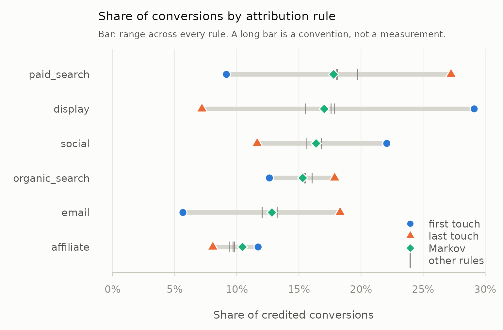
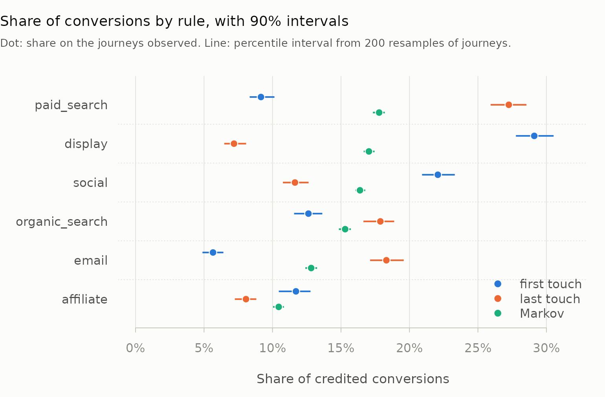

# Building journeys from event logs

Attribution packages consume journeys:
`"display > social > paid_search"` strings with conversion counts
attached. Producing those strings from a raw event log is usually left
to the analyst: `ChannelAttribution`, for instance, starts from the
aggregated paths, on the reasonable grounds that its job is Markov
removal effects and it does that in C++.

So the step gets done in analysis code, usually as a
[`group_by()`](https://dplyr.tidyverse.org/reference/group_by.html) and
a `paste(collapse = " > ")`. This vignette is about what that loses,
which is not small, and then about dividing credit among channels once
the journeys are right.

``` r

library(mediamix)
data(mm_events)

nrow(mm_events)
#> [1] 20799
head(mm_events)
#>   customer_id        channel           timestamp conversion value
#> 1  cust_03227          email 2025-02-10 18:08:57          0    NA
#> 2  cust_03940                2025-05-20 04:44:17          0    NA
#> 3  cust_04838 organic_search 2025-04-04 22:20:01          0    NA
#> 4  cust_00749      affiliate 2025-09-27 03:31:38          0    NA
#> 5  cust_05340           <NA> 2025-02-24 22:17:01          0    NA
#> 6  cust_05271         social 2025-02-18 19:00:56          0    NA
```

`mm_events` is a synthetic log of 20,799 touchpoint events across 5,400
customers. It contains, on purpose, everything a real export contains:
repeat converters, consecutive duplicate channels, direct and blank and
missing channel labels, customers who never convert, timestamp ties, and
rows in no particular order.

## The naive approach

One path per customer, in timestamp order:

``` r

ordered <- mm_events[order(mm_events$customer_id, mm_events$timestamp), ]
naive <- split(ordered$channel, ordered$customer_id)

c(journeys = length(naive), mean_length = mean(lengths(naive)))
#>    journeys mean_length 
#>    5400.000       3.852
```

5,400 journeys at a mean length of 3.85. Now the same log through
[`build_paths()`](https://elkronos.github.io/mediamix/reference/build_paths.md),
with its default settings:

``` r

paths <- build_paths(
  mm_events,
  id = "customer_id",
  channel = "channel",
  timestamp = "timestamp",
  conversion = "conversion",
  value = "value"
)
summary_built <- path_summary(paths)
summary_built
#>   events_in events_out journeys converting_journeys mean_length median_length
#> 1     20799      17282     6105                2741       2.831             3
#>   max_length direct_events conversion_events conversions_observed
#> 1          9          1597              2741                 2741
#>   conversions_unattributable journeys_before_filtering duplicate_events
#> 1                          0                      6105              117
```

6,105 journeys, 13% more, at a mean length of 2.83, 27% shorter. Journey
counts and lengths feed a Markov transition matrix directly, so
differences of this size carry through to the final numbers.

Here is where the difference comes from, one concern at a time.

``` r

step <- function(...) {
  s <- path_summary(build_paths(
    mm_events, id = "customer_id", channel = "channel",
    timestamp = "timestamp", conversion = "conversion", ...))
  c(journeys = s$journeys, mean_length = round(s$mean_length, 2))
}

steps <- rbind(
  `naive`                       = c(length(naive), round(mean(lengths(naive)), 2)),
  `split on conversion`         = step(split_on = "conversion",
                                       collapse_repeats = FALSE),
  `+ 30-day inactivity gap`     = step(split_on = c("conversion", "gap"),
                                       gap = 30, collapse_repeats = FALSE),
  `+ collapse duplicates`       = step(split_on = c("conversion", "gap"),
                                       gap = 30, collapse_repeats = TRUE)
)
steps
#>                         journeys mean_length
#> naive                       5400        3.85
#> split on conversion         6105        3.39
#> + 30-day inactivity gap     6105        3.39
#> + collapse duplicates       6105        2.83
```

Splitting on conversion accounts for every extra journey. The three
[`build_paths()`](https://elkronos.github.io/mediamix/reference/build_paths.md)
rows also drop the 117 exact duplicate events in the log
(`dedupe = TRUE`, the default). The 30-day inactivity split changes
nothing here: every gap that long in this log comes straight after a
conversion, where the journey has already been split. Collapsing
consecutive duplicates shortens the journeys further.

## The seven things that go wrong

### 1. Journey splitting

A customer who converts in March and again in September is two journeys.
Treat them as one and March’s touchpoints take credit for September’s
sale, while the journey count falls by every repeat conversion in the
file.

``` r

repeat_buyers <- table(mm_events$customer_id[mm_events$conversion == 1])
table(as.integer(repeat_buyers))
#> 
#>    1    2    3 
#> 1509  349  178
```

The table counts converting customers by how many times they converted.
Here 527 converted more than once, for 705 repeat conversions, and the
naive approach finds 705 fewer journeys than
[`build_paths()`](https://elkronos.github.io/mediamix/reference/build_paths.md).

[`build_paths()`](https://elkronos.github.io/mediamix/reference/build_paths.md)
splits on conversion by default (`split_on = "conversion"`). `split_on`
also accepts `"gap"`, so a customer who disappears for four months and
comes back starts a new journey rather than extending an eleven-month
one.

### 2. Lookback windows

A touch two years before a conversion did not cause it. Thirty, sixty
and ninety days are the standard choices, and none of them came from
your data.

[`conversion_lag()`](https://elkronos.github.io/mediamix/reference/conversion_lag.md)
measures how long converting journeys take, from first touch to
conversion, so you can read the window off your own data instead:

``` r

lags <- conversion_lag(paths)
lags
#>   quantile    lag
#> 1     0.50  4.535
#> 2     0.75  8.793
#> 3     0.90 13.492
#> 4     0.95 16.851
#> 5     0.99 23.538
#> 6     1.00 43.165
```

Ninety per cent of converting journeys in this log complete within about
13 days, so a 30-day window truncates almost nothing and a 90-day window
is pure decoration. The tail is real, though: the slowest journey takes
43 days, so a window is a decision about which tail to discard, not a
free simplification. On a considered-purchase category the same table
may tell you the opposite, and reading it takes one line.

### 3. Non-converting journeys

These null paths are kept by default (`keep_null_paths = TRUE`), and you
should think hard before changing that.
[`as_channel_paths()`](https://elkronos.github.io/mediamix/reference/as_channel_paths.md)
counts them for each distinct path, beside its conversions:

``` r

with_nulls <- as_channel_paths(paths)
head(with_nulls, 4)
#>             path total_conversions total_null total_conversion_value
#> 1         social                98         97                  13268
#> 2    paid_search                81         73                  10658
#> 3 organic_search                80         84                   8998
#> 4        display                79        118                   9628
c(converting = sum(with_nulls$total_conversions),
  null = sum(with_nulls$total_null))
#> converting       null 
#>       2741       3364
```

3,364 of the 6,105 journeys here never converted. Markov removal
effects, covered below, are computed *against* the null paths: the
transition matrix needs an absorbing failure state to compare the
conversion state with. Drop them and the conversion probability becomes
1, so every removal effect is measured against the wrong baseline and
moves up or down depending on how the dropped journeys differ from the
converting ones.
[`markov_removal()`](https://elkronos.github.io/mediamix/reference/markov_removal.md)
warns when a table has none.

### 4. Direct, none and missing channels

Every real log has them, and every tutorial handles them differently.
Here `direct = "label"` folds them into one channel:

``` r

table(build_paths(mm_events, id = "customer_id", channel = "channel",
                  timestamp = "timestamp", conversion = "conversion",
                  direct = "label")$channel)
#> 
#>       (direct)      affiliate        display          email organic_search 
#>           1581           1734           3011           2178           2741 
#>    paid_search         social 
#>           3203           2818
```

`"keep"`, the default, leaves the labels alone (naming the unnamed ones
`"(blank)"` and `"(missing)"` so they can be referred to at all),
`"label"` folds them into the one `"(direct)"` channel above, and
`"drop"` removes those touches entirely. The choice moves the numbers,
so it is an argument rather than fixed behaviour buried in the source.

### 5. Accounting for what gets dropped

Dropping direct traffic can strip a converting journey of every
touchpoint it had, including, sometimes, the touch that recorded the
conversion. mediamix fixes the conversion facts before any filtering, so
the conversion is never erased; it is counted and reported as
unattributable. A short lookback makes this more common, because the
window is measured back from the conversion even when the converting
touch itself is dropped. Here direct traffic is dropped and the lookback
cut to one day:

``` r

dropped <- build_paths(
  mm_events, id = "customer_id", channel = "channel",
  timestamp = "timestamp", conversion = "conversion",
  lookback = 1, direct = "drop"
)
path_summary(dropped)[, c("conversions_observed", "converting_journeys",
                          "conversions_unattributable")]
#>   conversions_observed converting_journeys conversions_unattributable
#> 1                 2741                2540                        201
```

Those 201 conversions happened. They cannot be credited to any channel
under these settings, and a pipeline that quietly reports a smaller
denominator is lying by omission.

### 6. Consecutive duplicates

Three page views on the same channel are usually one exposure recorded
three times. Collapsing them is what takes the mean journey length from
3.39 to 2.83 in the table above. `collapse_repeats = TRUE`, the default,
keeps the *first* touch of each run, preserving when the channel entered
the journey. If you are using
[`credit_time_decay()`](https://elkronos.github.io/mediamix/reference/credit.md),
consider `FALSE`, since keeping the first of a run pushes each channel’s
apparent recency backward.

### 7. Deterministic ordering

Logs written at second resolution are full of ties.
[`build_paths()`](https://elkronos.github.io/mediamix/reference/build_paths.md)
breaks them by original row order, except that a conversion sorts after
every touch sharing its timestamp, so the same input always gives the
same journeys. Without a fixed tie-break, first-touch and last-touch
results are not reproducible.

## Assigning credit

mediamix has five credit rules:
[`credit_first()`](https://elkronos.github.io/mediamix/reference/credit.md),
[`credit_last()`](https://elkronos.github.io/mediamix/reference/credit.md),
[`credit_linear()`](https://elkronos.github.io/mediamix/reference/credit.md),
[`credit_position()`](https://elkronos.github.io/mediamix/reference/credit.md)
and
[`credit_time_decay()`](https://elkronos.github.io/mediamix/reference/credit.md),
plus
[`credit_custom()`](https://elkronos.github.io/mediamix/reference/credit.md)
for your own. Each returns the journey table with a `credit` column, so
they can be compared side by side.

``` r

lin <- credit_linear(paths)
head(lin[, c("path_id", "channel", "touch_rank", "touch_n", "credit")])
#>        path_id        channel touch_rank touch_n credit
#> 1 cust_00001#1 organic_search          1       1    1.0
#> 2 cust_00001#2        display          1       5    0.2
#> 3 cust_00001#2 organic_search          2       5    0.2
#> 4 cust_00001#2          email          3       5    0.2
#> 5 cust_00001#2         social          4       5    0.2
#> 6 cust_00001#2 organic_search          5       5    0.2
```

Credit sums to 1 within every converting journey, and total credit
equals the number of attributable conversions. That invariant catches
journeys silently dropped in construction:

``` r

c(total_credit = sum(lin$credit),
  attributable = path_summary(paths)$converting_journeys)
#> total_credit attributable 
#>         2741         2741
```

[`attribute()`](https://elkronos.github.io/mediamix/reference/attribute.md)
runs the five rules and the Markov model described below at once, which
is the point:

``` r

res <- attribute(paths)
head(res, 8)
#>     rule        channel conversions   share value touches
#> 1 linear    paid_search      494.41 0.18037 63270    3203
#> 2 linear        display      482.36 0.17598 60242    3011
#> 3 linear         social      460.37 0.16796 59183    2818
#> 4 linear organic_search      425.07 0.15508 51503    2741
#> 5 linear          email      329.58 0.12024 42201    2178
#> 6 linear      affiliate      265.93 0.09702 33558    1734
#> 7 linear        (blank)       91.17 0.03326 11382     465
#> 8 linear         (none)       81.74 0.02982  9641     427
```

Each row is one rule and channel: `conversions` is the credit the
channel received, `share` its fraction of that rule’s total, `value` the
conversion value credited to it, and `touches` the channel’s touchpoints
in every journey, converting or not.

## The spread is the finding

Any single rule gives you a number. Several rules give you the range
that number could have been, which is more honest and usually more
useful:

``` r

spread <- attribution_spread(res)
spread
#>           channel min_share max_share mean_share    spread first_last_ratio
#> 1         display   0.07187   0.29113    0.17382 0.2192630           4.0508
#> 2     paid_search   0.09157   0.27253    0.18343 0.1809559           0.3360
#> 3           email   0.05655   0.18314    0.12350 0.1265961           0.3088
#> 4          social   0.11638   0.22072    0.16554 0.1043415           1.8966
#> 5  organic_search   0.12623   0.17877    0.15471 0.0525356           0.7061
#> 6       affiliate   0.08063   0.11711    0.09861 0.0364830           1.4525
#> 7          direct   0.02225   0.02683    0.02411 0.0045738           1.0492
#> 8         (blank)   0.02955   0.03379    0.03176 0.0042353           0.9419
#> 9          (none)   0.02736   0.02982    0.02849 0.0024578           1.0133
#> 10      (missing)   0.01569   0.01637    0.01604 0.0006824           1.0233
```

[`plot()`](https://rdrr.io/r/graphics/plot.default.html) draws the same
table for the six channels with the largest mean share. Each bar is the
range a channel’s share covers across all six rules, with the
first-touch, last-touch and Markov shares marked:

``` r

plot(res, n = 6)
```



Display’s share runs from 7% under last-touch to 29% under first-touch,
depending only on the convention chosen. That channel has not been
measured; it has been assigned a number. Paid search and email move the
other way, with their largest shares under last-touch.
[`channel_positions()`](https://elkronos.github.io/mediamix/reference/channel_positions.md)
says why. It counts how often each channel is the only, first, middle or
last touch of a converting journey:

``` r

positions <- channel_positions(paths)
positions
#>           channel only first middle last touches first_last_ratio
#> 1     paid_search   81   170    503  666    1420           0.2553
#> 2         display   79   719    437  118    1353           6.0932
#> 3          social   98   507    450  221    1276           2.2941
#> 4  organic_search   80   266    467  410    1223           0.6488
#> 5           email   46   109    363  456     974           0.2390
#> 6       affiliate   40   281    277  181     779           1.5525
#> 7         (blank)   27    54     79   59     219           0.9153
#> 8          (none)   19    57     73   56     205           1.0179
#> 9          direct   13    51     58   48     170           1.0625
#> 10      (missing)    9    35     34   34     112           1.0294
```

Display opens journeys: it appears first about 6 times for every time it
appears last, while paid search and email close them. First-touch and
last-touch attribution therefore disagree about them by construction,
and reporting either one alone is choosing a side of that disagreement
without saying so.

Both tables carry a column called `first_last_ratio`, and they are
different quantities. Here it is a ratio of touchpoint *counts* (6.09
for display); in
[`attribution_spread()`](https://elkronos.github.io/mediamix/reference/attribution_spread.md)
above it is a ratio of credited *shares* (4.05). Both say display opens
journeys; they are measured in different currencies and will not agree
numerically.

The assist matrix from
[`assisted_conversions()`](https://elkronos.github.io/mediamix/reference/assisted_conversions.md)
is the other half of the picture:

``` r

real <- c("display", "social", "organic_search", "paid_search", "email")
assists <- assisted_conversions(paths, normalise = TRUE)
round(assists[real, real], 3)
#>                 assisted
#> assisting        display social organic_search paid_search email
#>   display          0.101  0.259          0.316       0.415 0.303
#>   social           0.176  0.117          0.267       0.391 0.288
#>   organic_search   0.135  0.167          0.125       0.296 0.225
#>   paid_search      0.096  0.125          0.191       0.128 0.179
#>   email            0.090  0.128          0.166       0.250 0.068
```

Read a row as “this channel assisted these channels”. Display precedes
paid search in 42% of the converting journeys display appears in; paid
search precedes display in only 10% of its own. That asymmetry is the
same finding as the first-versus-last ratio, seen pairwise rather than
in aggregate.

## Time decay, and the connection to adstock

[`credit_time_decay()`](https://elkronos.github.io/mediamix/reference/credit.md)
spreads a conversion’s credit backward across prior touchpoints with
geometric decay, the same kernel
[`adstock_geometric()`](https://elkronos.github.io/mediamix/reference/adstock_geometric.md)
uses to spread spend forward, and the same `decay` vocabulary. Here the
half-life is three days:

``` r

td <- credit_time_decay(paths, decay = decay_from_half_life(3))
example <- td[td$path_id == td$path_id[td$converted & td$touch_n >= 4][1], ]
example[, c("channel", "touch_rank", "time_to_conversion", "credit")]
#>          channel touch_rank time_to_conversion   credit
#> 2        display          1             16.525 0.009904
#> 3 organic_search          2              5.862 0.116358
#> 4          email          3              5.005 0.141849
#> 5         social          4              2.045 0.281075
#> 6 organic_search          5              0.000 0.450814
```

A touch’s credit halves for every three days between it and the
conversion. That symmetry with adstock is not a coincidence:
[`vignette("spine")`](https://elkronos.github.io/mediamix/articles/spine.md)
puts the two kernels side by side and shows where the symmetry stops.

## Data-driven attribution: Markov removal effects

The five rules above are conventions chosen in advance. The Markov model
of Anderl et al. (2016) lets the journeys choose instead. It fits a
transition matrix from start, through channels, to conversion or null,
and credits each channel by its *removal effect*: the proportional fall
in the probability of converting when every transition into that channel
is sent to null instead.

[`markov_removal()`](https://elkronos.github.io/mediamix/reference/markov_removal.md)
fits the order-1 model exactly, from the absorbing-chain fundamental
matrix, in base R:

``` r

mk <- markov_removal(paths)
mk
#>           channel removal_effect conversions   share value p_without
#> 1     paid_search        0.43712      487.56 0.17788 61315    0.2527
#> 2         display        0.41872      467.04 0.17039 58734    0.2610
#> 3          social        0.40269      449.15 0.16386 56484    0.2682
#> 4  organic_search        0.37610      419.50 0.15305 52755    0.2801
#> 5           email        0.31515      351.52 0.12824 44206    0.3075
#> 6       affiliate        0.25689      286.53 0.10453 36033    0.3336
#> 7         (blank)        0.07606       84.84 0.03095 10669    0.4148
#> 8          (none)        0.06855       76.46 0.02790  9616    0.4182
#> 9          direct        0.06593       73.54 0.02683  9248    0.4194
#> 10      (missing)        0.04023       44.87 0.01637  5643    0.4309
attr(mk, "p_conversion")
#> [1] 0.449
```

`p_conversion` is the baseline, the model’s probability that a journey
converts, and `p_without` the same probability once the channel is
removed, so `removal_effect` is `1 - p_without / p_conversion`. Each
channel’s `conversions` are the converting journeys divided in
proportion to the removal effects. The null paths are what make this
work: they are how the model learns how often a journey ends in nothing,
which is why
[`build_paths()`](https://elkronos.github.io/mediamix/reference/build_paths.md)
keeps them by default.
[`attribute()`](https://elkronos.github.io/mediamix/reference/attribute.md)
runs this model as its `"markov"` rule, so the spread table above
already included it:

``` r

res[res$rule == "markov", c("channel", "conversions", "share")]
#>           channel conversions   share
#> 51    paid_search      487.56 0.17788
#> 52        display      467.04 0.17039
#> 53         social      449.15 0.16386
#> 54 organic_search      419.50 0.15305
#> 55          email      351.52 0.12824
#> 56      affiliate      286.53 0.10453
#> 57        (blank)       84.84 0.03095
#> 58         (none)       76.46 0.02790
#> 59         direct       73.54 0.02683
#> 60      (missing)       44.87 0.01637
```

Markov attribution is still not incrementality. Removing a state from a
chain assumes every customer who would have passed through it is lost
and none finds another route to the same purchase. It is a more
data-driven convention than first-touch, and a convention nonetheless.

## Sampling noise and segments

The spread measures how much a share depends on the rule.
`attribute(times =)` measures how much it depends on the sample: it
draws the journeys with replacement `times` times, reruns every rule on
each draw, and adds percentile intervals, 90% by default, as `lower` and
`upper`. `seed` makes them reproducible, and
[`plot()`](https://rdrr.io/r/graphics/plot.default.html) draws each
rule’s share with its interval:

``` r

boot <- attribute(paths, rules = c("first", "last", "markov"), times = 200,
                  seed = 1)
boot[boot$channel == "display", c("rule", "share", "lower", "upper")]
#>      rule   share   lower   upper
#> 1   first 0.29113 0.27774 0.30526
#> 16   last 0.07187 0.06477 0.08073
#> 22 markov 0.17039 0.16656 0.17452
plot(boot, n = 6)
```



No interval in `boot` is wider than 2.8 percentage points, while
display’s share moves 22 points between rules. The intervals hold the
journey construction and each rule fixed, and they treat a customer’s
several journeys as unrelated draws.

To compare segments, such as devices or campaigns, carry the column into
the journey table with `build_paths(keep =)` and name it in
`attribute(by =)`. Every rule then runs on each segment’s journeys
alone, so each rule’s shares sum to 1 within each segment. A segment
column must take one value per journey; `mm_events` has none.

## Handing off to ChannelAttribution

For higher-order chains, `ChannelAttribution` estimates the same removal
effects in C++.
[`as_channel_paths()`](https://elkronos.github.io/mediamix/reference/as_channel_paths.md)
exports the journeys in exactly the format it expects:

``` r

# ChannelAttribution splits paths on ">", so export with the same separator.
ca <- as_channel_paths(paths, sep = ">")
head(ca, 4)
#>             path total_conversions total_null total_conversion_value
#> 1         social                98         97                  13268
#> 2    paid_search                81         73                  10658
#> 3 organic_search                80         84                   8998
#> 4        display                79        118                   9628
```

``` r

ChannelAttribution::markov_model(
  ca, var_path = "path",
  var_conv = "total_conversions", var_null = "total_null", sep = ">"
)
#> 
#> Number of simulations: 100000 - Convergence reached: 1.90% < 5.00%
#> 
#> Percentage of simulated paths that successfully end before maximum number of steps (10) is reached: 99.11%
#> 
#> [1] "*** Install ChannelAttribution Pro for free running install_pro(). Visit https://channelattribution.io for more info. Set flg_pro=FALSE to hide this message."
#>      channel_name total_conversions
#> 1          social            450.45
#> 2     paid_search            493.05
#> 3  organic_search            417.43
#> 4         display            464.31
#> 5           email            356.17
#> 6       affiliate            279.04
#> 7         (blank)             82.17
#> 8          (none)             75.87
#> 9          direct             75.62
#> 10      (missing)             46.88
```

For `order = 1`, ChannelAttribution and
[`markov_removal()`](https://elkronos.github.io/mediamix/reference/markov_removal.md)
should agree up to ChannelAttribution’s simulation error.

## What attribution cannot tell you

Rule-based attribution is a bookkeeping convention, not a causal
estimate. It divides observed conversions among observed touchpoints
according to a rule you chose. It cannot tell you what would have
happened if a channel had not run, because that outcome is not in the
log. No rule, however sophisticated, recovers a counterfactual from data
that does not contain one. Only an experiment, or a credible
quasi-experiment, does.

Well-built journeys make the bookkeeping honest, comparable across
rules, and reproducible. That is worth a great deal. It is not
incrementality.

## References

Anderl, E., Becker, I., von Wangenheim, F. and Schumann, J. H. (2016).
Mapping the customer journey: Lessons learned from graph-based online
attribution modeling. *International Journal of Research in Marketing*,
33(3), 457–474. <https://doi.org/10.1016/j.ijresmar.2016.03.001>
