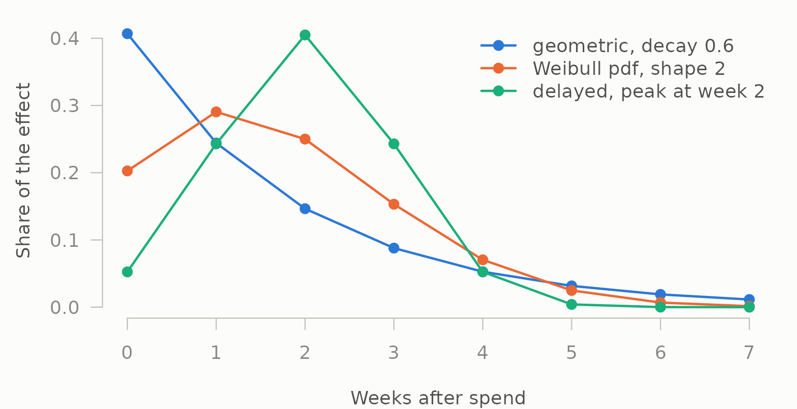
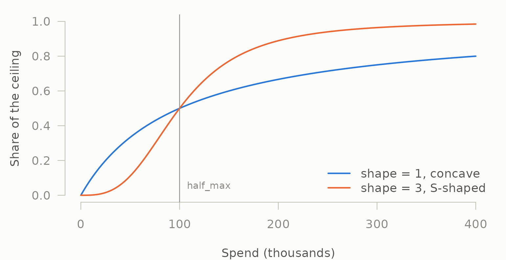
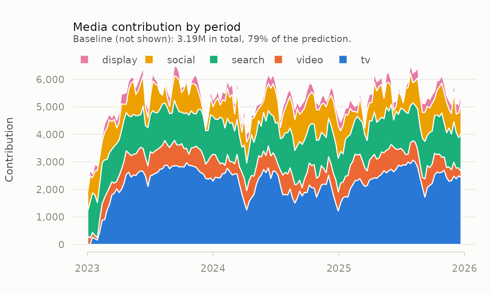
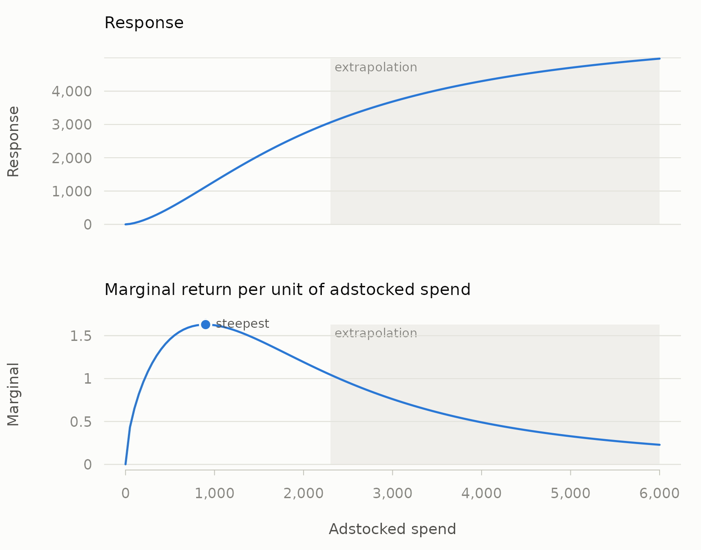

# Getting started

mediamix turns raw marketing data into model-ready features. It does two
things, and deliberately not a third: it converts media spend into
carryover- and saturation-adjusted regressors, and it converts raw event
logs into attributed customer journeys. It does not fit models.
[`lm()`](https://rdrr.io/r/stats/lm.html), `glmnet` and `brms` already
do that better than a marketing package would.

This vignette walks the whole arc on the media side: raw weekly spend,
through diagnostics and transforms, to a fitted model, contributions and
return on investment. It uses `mm_weekly`, three years of synthetic
weekly spend, price and revenue for three geographies, generated from
known parameters so that the estimates can be checked against the truth.
Most of the work is on the north geography:

``` r

library(mediamix)
data(mm_weekly)

north <- mm_weekly[mm_weekly$geo == "north", ]
channels <- c("tv", "video", "search", "social", "display")
str(north[, c("date", channels, "price", "revenue")])
#> 'data.frame':    156 obs. of  8 variables:
#>  $ date   : Date, format: "2023-01-02" "2023-01-09" ...
#>  $ tv     : num  0 0 2193 0 0 ...
#>  $ video  : num  399 0 0 0 0 584 482 824 0 251 ...
#>  $ search : num  277 488 568 576 401 424 614 481 357 423 ...
#>  $ social : num  296 328 0 303 500 182 126 348 435 428 ...
#>  $ display: num  0 280 0 251 0 306 0 348 222 0 ...
#>  $ price  : num  22.1 25 25.3 25 26.8 ...
#>  $ revenue: num  27130 20433 20481 20565 17574 ...
```

## Look before you transform

Many marketing mix projects fail for reasons visible in the data before
any model is fitted.
[`diagnose_media()`](https://elkronos.github.io/mediamix/reference/diagnose_media.md)
checks for five of them: channels that move together, channels that
barely vary, channels that are dark (spend nothing) in most weeks, an
erratic cost per mille when impressions are supplied, and, given a
`date` column, rows out of time order, repeated weeks and gaps, none of
which adstock notices, since it takes adjacent rows as adjacent weeks.
With `by = "geo"` it runs each check within each geography and reports
the worst case.

``` r

diagnose_media(mm_weekly, media = channels, by = "geo", date = "date")
#> 
#> ── Media diagnostics
#> 468 observations across 3 series, 5 channels
#> Time index: every series is in order, with one row per period and no gaps.
#> ✔ No structural problems found.
#> 
#> Inspect $variation, $collinearity, $correlations, $dates.
```

Nothing structural is wrong here, which is what you would expect from
synthetic data. On real data this is where you learn that two channels
were planned together and their coefficients will therefore flip sign on
small changes to the specification. The detail is in the elements the
printout names, starting with the spend statistics in `$variation`:

``` r

d <- diagnose_media(mm_weekly, media = channels, by = "geo")
d$variation
#>   channel   mean    sd     cv distinct zero_share low_variation
#> 1      tv 1700.5 881.7 0.5096      131     0.1474         FALSE
#> 2   video  336.3 308.6 0.8939       84     0.4167         FALSE
#> 3  search  487.1 115.6 0.2286      118     0.0000         FALSE
#> 4  social  251.2 174.9 0.6613      101     0.2756         FALSE
#> 5 display  188.1 149.3 0.7584       88     0.3333         FALSE
#>   heavily_flighted usable
#> 1            FALSE   TRUE
#> 2            FALSE   TRUE
#> 3            FALSE   TRUE
#> 4            FALSE   TRUE
#> 5            FALSE   TRUE
```

With `by` supplied, `cv`, `distinct` and `zero_share` report the worst
case across series, which is what you want from a diagnostic, while
`mean` and `sd` are averages over the series. So read `zero_share`, the
share of weeks with no spend, as the worst geography’s rate, not an
overall average. `video` goes dark in 42% of weeks in its worst
geography and `display` in 33%. That is normal, because media is
flighted (bought in bursts with gaps between them), but it means those
channels carry less information than 156 weeks per geography suggests.

## Carryover

Advertising does not stop working the week it runs. Adstock spreads each
period’s spend forward with geometric decay, using a set of weights
called the kernel.

``` r

spend <- c(100, 0, 0, 0, 0, 0)
round(adstock_geometric(spend, decay = 0.5), 2)
#> [1] 50.00 25.00 12.50  6.25  3.12  1.56
```

By default the kernel’s weights sum to one, so the burst of 100 is
spread out rather than repeated: half of it lands in the week of spend,
a quarter in the week after, and so on. The section on normalisation
below says why that matters.

Practitioners think in half-lives, not decay coefficients, so the
package provides the translation:

``` r

theta <- decay_from_half_life(3)   # a three-week half-life on weekly data
theta
#> [1] 0.7937
half_life(theta)
#> [1] 3
effective_window(theta, coverage = 0.90)
#> [1] 10
```

`decay_from_half_life(3)` is the weekly decay for a three-week
half-life, and
[`half_life()`](https://elkronos.github.io/mediamix/reference/decay_vocabulary.md)
converts it back. The last line says that carryover with this half-life
needs 10 weeks to deliver 90% of its effect, which is how you decide
whether truncating the kernel (the `max_lag` argument) costs you
anything, and whether 156 weeks of data can identify a carryover this
long at all.

### Normalisation changes what your coefficient means

`normalise` is the argument that most often changes an answer without
anyone noticing, so it is explicit rather than implied.

``` r

constant <- rep(100, 50)
tail(adstock_geometric(constant, decay = 0.8), 1)
#> [1] 100
tail(adstock_geometric(constant, decay = 0.8, normalise = FALSE), 1)
#> [1] 500
```

Normalised, the kernel sums to 1: once the filter has filled up, a
constant spend of 100 adstocks to 100, the series level is preserved,
and the fitted coefficient reads as the effect of *one unit of media*.
Unnormalised (raw Koyck accumulation), the same series accumulates to
`100 / (1 - 0.8)`, and the coefficient reads as the effect of one unit
of *accumulated* media. Both are defensible. Comparing a coefficient
fitted one way against a coefficient fitted the other is not.

mediamix defaults to normalised, as does the Bayesian media mix model of
Jin et al. (2017). Robyn’s geometric adstock does not, so if you are
reconciling against Robyn, set `normalise = FALSE`.

### Dark weeks

Media data is full of zero-spend weeks, and carryover has to survive
them:

``` r

flighted <- c(100, 100, 0, 0, 0, 0, 100)
round(adstock_geometric(flighted, decay = 0.6), 2)
#> [1] 40.00 64.00 38.40 23.04 13.82  8.29 44.98
```

Carryover decays across the gap rather than resetting, and the new burst
adds to what is left.

### Delayed peaks

A geometric kernel always peaks in the period of spend. Television and
out-of-home often do not, and no decay rate fixes that. Weibull adstock
with `type = "pdf"` can, and so can the delayed kernel of Jin et
al. (2017), whose `peak` is read directly in weeks. The three kernels’
weights over eight weeks:

``` r

w_geo <- adstock_weights(8, decay = 0.6)
w_wei <- adstock_weights_weibull(8, shape = 2, scale = 3, type = "pdf")
w_del <- adstock_weights_delayed(8, decay = 0.6, peak = 2)
round(rbind(geometric = w_geo, weibull = w_wei, delayed = w_del), 3)
#>            [,1]  [,2]  [,3]  [,4]  [,5]  [,6]  [,7]  [,8]
#> geometric 0.407 0.244 0.146 0.088 0.053 0.032 0.019 0.011
#> weibull   0.203 0.290 0.250 0.153 0.070 0.025 0.007 0.001
#> delayed   0.052 0.243 0.405 0.243 0.052 0.004 0.000 0.000
which.max(w_wei)
#> [1] 2
```

The first column is the week of spend. The Weibull kernel’s largest
weight is in column 2, 1 week after the spend, and the delayed kernel’s
is 2 weeks after it. The three shapes side by side:

``` r

cols <- mm_palette(3)
ink <- mm_palette(role = "ink")
op <- par(mar = c(4, 4.5, 1, 1), bg = ink[["surface"]], fg = ink[["axis"]])
matplot(0:7, cbind(w_geo, w_wei, w_del), type = "o", pch = 19, lty = 1,
        lwd = 2, col = cols, xlab = "Weeks after spend",
        ylab = "Share of the effect", las = 1, bty = "n",
        col.axis = ink[["muted"]], col.lab = ink[["secondary"]])
legend("topright", c("geometric, decay 0.6", "Weibull pdf, shape 2",
                     "delayed, peak at week 2"),
       col = cols, lwd = 2, pch = 19, bty = "n", text.col = ink[["secondary"]])
```



``` r

par(op)
```

## Saturation

Adstock says *when* money works. Saturation says how hard it works at
the margin.
[`saturate_hill()`](https://elkronos.github.io/mediamix/reference/saturation.md)
maps media onto a share of the channel’s ceiling, between 0 and 1. Its
`half_max` is the spend at which the response reaches half its ceiling,
which is interpretable in the units you actually budget in. Its `shape`
sets the form of the curve: `shape = 1`, the default, is concave, and
`shape > 1` produces the threshold effect below which media barely
registers. Both forms at six levels of spend, with `half_max` at
100,000:

``` r

levels <- c(0, 25, 50, 100, 200, 400) * 1000
round(rbind(
  concave = saturate_hill(levels, half_max = 100000),
  s_shape = saturate_hill(levels, half_max = 100000, shape = 3)
), 3)
#>         [,1]  [,2]  [,3] [,4]  [,5]  [,6]
#> concave    0 0.200 0.333  0.5 0.667 0.800
#> s_shape    0 0.015 0.111  0.5 0.889 0.985
```

``` r

grid_spend <- seq(0, 400000, by = 2000)
op <- par(mar = c(4, 4.5, 1, 1), bg = ink[["surface"]], fg = ink[["axis"]])
plot(grid_spend / 1000, saturate_hill(grid_spend, half_max = 100000),
     type = "l", lwd = 2, col = cols[1], ylim = c(0, 1), las = 1, bty = "n",
     xlab = "Spend (thousands)", ylab = "Share of the ceiling",
     col.axis = ink[["muted"]], col.lab = ink[["secondary"]])
lines(grid_spend / 1000, saturate_hill(grid_spend, 100000, shape = 3),
      lwd = 2, col = cols[2])
abline(v = 100, col = ink[["muted"]])
text(100, 0.05, "half_max", pos = 4, cex = 0.8, col = ink[["muted"]])
legend("bottomright", c("shape = 1, concave", "shape = 3, S-shaped"),
       col = cols[1:2], lwd = 2, bty = "n", text.col = ink[["secondary"]])
```



``` r

par(op)
```

Both curves reach half the ceiling at `half_max`. Below it the S-shaped
curve barely registers; above it, the S-shaped curve closes on the
ceiling faster than the concave one.

## Composing carryover and saturation in the right order

Saturation goes *after* adstock. Saturating first puts each period’s
spend through the curve in isolation, so carryover from earlier periods
never counts towards saturation; with `normalise = FALSE` the kernel
weights sum to more than one and carryover also lifts the result past
the ceiling.
[`media_transform()`](https://elkronos.github.io/mediamix/reference/media_transform.md)
composes them in the right order and warns if asked to reverse it.

`mm_weekly` was generated from known parameters, attached as its
`"truth"` attribute, so here we can transform each channel with the
right decay, `half_max` and `shape`. A `saturation` list without a
`type` uses the Hill curve. On real data you do not know these
parameters:
[`vignette("carryover")`](https://elkronos.github.io/mediamix/articles/carryover.md)
shows how to choose the decays, and
[`vignette("tidymodels")`](https://elkronos.github.io/mediamix/articles/tidymodels.md)
how to tune them together with the saturation parameters.

`spec` holds one entry per channel, in the form
[`media_transform()`](https://elkronos.github.io/mediamix/reference/media_transform.md)
takes, and
[`transform_plan()`](https://elkronos.github.io/mediamix/reference/transform_plan.md)
runs each channel’s column of the plan through its own entry:

``` r

truth <- attr(mm_weekly, "truth")

spec <- lapply(stats::setNames(channels, channels), function(ch) list(
  adstock = list(decay = truth$decay[[ch]]),
  saturation = list(half_max = truth$half_max[[ch]],
                    shape = truth$shape[[ch]])
))
transformed <- transform_plan(north, spec)[channels]
round(head(transformed, 4), 4)
#>       tv  video search social display
#> 1 0.0000 0.1663 0.3435 0.3175  0.0000
#> 2 0.0000 0.1225 0.5001 0.4202  0.2958
#> 3 0.0441 0.0890 0.5501 0.2459  0.1877
#> 4 0.0343 0.0640 0.5598 0.3838  0.3349
```

Each column is now a share of its channel’s ceiling, between 0 and 1.

## Fit whatever model you like

mediamix stops here. The transformed columns are ordinary numeric
vectors, so any modelling function will take them. Here
[`lm()`](https://rdrr.io/r/stats/lm.html) fits revenue on the five
channels and the controls the data were simulated with (a weekly trend,
price, the seasonal index and a December flag). The output sets the
estimates against the true coefficients, then gives each estimate’s
error in per cent:

``` r

model_data <- transformed
model_data$week <- seq_len(nrow(model_data))
model_data$price <- north$price
model_data$seasonality <- north$seasonality
model_data$holiday <- north$holiday

fit <- lm(north$revenue ~ ., data = model_data)
estimates <- rbind(estimate = coef(fit)[channels],
                   truth = truth$beta[channels])
round(estimates)
#>            tv video search social display
#> estimate 6013  1885   2622   2258     760
#> truth    5200  2400   4100   1800     900
round(100 * (estimates["estimate", ] / estimates["truth", ] - 1))
#>      tv   video  search  social display 
#>      16     -21     -36      25     -16
```

Close, not exact: the estimates miss the truth by between 16% and 36%.
156 weekly observations of flighted, mildly correlated media is a hard
estimation problem, and pretending otherwise is how marketing mix models
acquire their reputation.

The controls are doing real work. Drop them and the media coefficients
absorb the trend and the price effect instead:

``` r

bare <- lm(north$revenue ~ ., data = transformed)
round(rbind(true = truth$beta[channels],
            with_controls = coef(fit)[channels],
            without = coef(bare)[channels]))
#>                 tv video search social display
#> true          5200  2400   4100   1800     900
#> with_controls 6013  1885   2622   2258     760
#> without       6110  1486   -218  -2067    2757
```

Without them 2 of the 5 media coefficients turn negative, and `search`
collapses from 2622 to -218. Nothing about the transform changed; the
specification did.

## Contributions and ROI

A marketing mix deliverable is the decomposition rather than the
coefficients: how much of predicted revenue each channel produced.
[`contributions()`](https://elkronos.github.io/mediamix/reference/contributions.md)
multiplies each transformed channel by its coefficient, week by week,
and pools everything else the model predicts into a `"(baseline)"`
channel. Totals over the three years:

``` r

contrib <- contributions(transformed, fit, index = north$date)
round(tapply(contrib$contribution, contrib$channel, sum))
#> (baseline)    display     search     social         tv      video 
#>    3190425      40853     208307     132709     349629     102461
```

`"(baseline)"` is everything the model predicts that this decomposition
does not attribute to the supplied media: the intercept, the trend,
price, seasonality and the December uplift, pooled. It is *not* organic
demand, and reporting it as such is a common way for one of these decks
to overstate its own precision.

Pooling the rest into the baseline is what makes the arithmetic close
exactly: in every week, the contributions sum to the model’s fitted
value.

``` r

totals <- as.numeric(tapply(contrib$contribution, contrib$period, sum))
all.equal(totals, unname(fitted(fit)))
#> [1] TRUE
```

Media’s share of predicted revenue over the three years:

``` r

media_share <- 1 - sum(contrib$contribution[contrib$channel == "(baseline)"]) /
  sum(contrib$contribution)
round(media_share, 3)
#> [1] 0.207
```

Media accounts for 21% of predicted revenue here, and the baseline for
the rest. Over time, with the baseline left out so the media is visible:

``` r

plot(contrib)
```



The dip at the very start of 2023 is the cold start: television’s long
carryover takes weeks to fill from zero.
[`adstock_steady_state()`](https://elkronos.github.io/mediamix/reference/adstock_steady_state.md)
removes it when that matters, as
[`vignette("carryover")`](https://elkronos.github.io/mediamix/articles/carryover.md)
shows.

[`roi()`](https://elkronos.github.io/mediamix/reference/roi.md) divides
each channel’s total contribution by its total spend, which gives the
average return per pound, and sorts the channels by it:

``` r

roi(contrib, north[channels])
#>   channel contribution  spend   roi
#> 1  social       132709  36716 3.614
#> 2  search       208307  74560 2.794
#> 3   video       102461  53248 1.924
#> 4 display        40853  26937 1.517
#> 5      tv       349629 266978 1.310
```

### Average and marginal return are different questions

Average ROI is a scorecard. Marginal ROI, what the *next* pound returns,
is the decision variable, and it is the only one of the two that should
drive a reallocation.

The tempting shortcut is to differentiate the saturation curve at the
mean adstocked level and multiply by the kernel’s first weight,
`1 - decay`, on the grounds that a pound spent this week only adds that
much to this week’s adstock. It does, but it also adds to every later
week’s adstock, and under a normalised kernel those contributions sum to
the whole pound. The shortcut measures the return *inside the week of
spend* and ignores the rest, which for a slow channel is most of it.

[`marginal_roi()`](https://elkronos.github.io/mediamix/reference/marginal_roi.md)
avoids the calculus altogether. It re-runs the full transform on a
budget 1% larger in every week and divides the extra response by the
extra spend, the definition used by Jin et al. (2017) and by Google’s
Meridian, so carryover and flighting are both handled by construction,
and the result is a total over the same weeks as the average. Given the
spend plan, the coefficients and `spec`, it does every channel at once:

``` r

marginal <- marginal_roi(north, coef(fit), spec = spec)
marginal[, c("channel", "roi", "mroi")]
#>   channel   roi   mroi
#> 1      tv 1.310 1.2534
#> 2   video 1.924 1.1961
#> 3  search 2.794 1.3490
#> 4  social 3.614 2.0892
#> 5 display 1.517 0.9324
```

Because both are totals over the observed weeks, response that the last
weeks’ spend would produce after the data end is not counted. For a
budget decision, the `extend` argument counts it;
[`?marginal_roi`](https://elkronos.github.io/mediamix/reference/marginal_roi.md)
shows how much it matters.

Compare the shortcut for television, whose decay of 0.85 means only 15%
of a week’s spend lands in that week’s adstock:

``` r

z_tv <- adstock_geometric(north$tv, decay = truth$decay[["tv"]])
shortcut <- mroi(mean(z_tv), coefficient = coef(fit)[["tv"]],
                 half_max = truth$half_max[["tv"]],
                 shape = truth$shape[["tv"]]) * (1 - truth$decay[["tv"]])
c(shortcut = shortcut, simulated = marginal$mroi[marginal$channel == "tv"])
#>  shortcut simulated 
#>    0.2059    1.2534
```

The shortcut understates television’s marginal return about 6-fold, and
a reallocation built on it would strip budget from exactly the channel
whose effect arrives late.

Read the `mroi` column of the
[`marginal_roi()`](https://elkronos.github.io/mediamix/reference/marginal_roi.md)
table instead. In this fitted model display’s average pound returns
about 1.5, but its *next* pound returns 0.93, less than it costs, and
the average-ROI table hides that completely. Search and social have
average returns 2.1 and 1.7 times their marginal ones: concave curves,
well up the slope. Television is the odd one out: its marginal return is
close to its average, because its S-shaped curve (a `shape` of 1.6) is
still near its steepest section at this budget. Under a concave curve
marginal is below average everywhere; under an S-curve it can be close
to or even above it below the inflection point, and assuming otherwise
is how a threshold channel stays starved.

Every figure above comes from a model fitted to 156 noisy weeks. The
data were simulated, so the fitted marginal returns can be set against
the ones the true coefficients give:

``` r

true_marginal <- marginal_roi(north, truth$beta, spec = spec)
true_mroi <- stats::setNames(true_marginal$mroi, true_marginal$channel)
round(rbind(fitted = stats::setNames(marginal$mroi, marginal$channel),
            truth = true_mroi), 2)
#>          tv video search social display
#> fitted 1.25  1.20   1.35   2.09    0.93
#> truth  1.08  1.52   2.11   1.67    1.10
```

With the true coefficients display’s next pound returns 1.1, and the
channels rank differently. Sampling noise in three years of weekly data
is enough to move a marginal return across break-even, which is why a
reallocation suggested by these numbers should be tested before it is
made. The [budget
walkthrough](https://elkronos.github.io/mediamix/articles/budget-walkthrough.html)
on the package website puts bootstrap intervals on these marginal
returns with
[`block_bootstrap()`](https://elkronos.github.io/mediamix/reference/block_bootstrap.md)
and tests a reallocation before recommending one.

### The response curve

[`response_curve()`](https://elkronos.github.io/mediamix/reference/response_curve.md)
evaluates one channel’s fitted curve, its coefficient times its
saturation curve, at a range of adstocked media levels, and gives the
marginal return at each. Under a normalised kernel a steady weekly spend
settles at the same adstocked level, so the spend axis can be read as
sustained weekly spend.
[`spend_for()`](https://elkronos.github.io/mediamix/reference/response_curve.md)
inverts the curve: it returns the level that reaches a target response.
For television:

``` r

curve <- response_curve(
  spend = seq(0, 6000, by = 1000),
  coefficient = coef(fit)[["tv"]],
  half_max = truth$half_max[["tv"]], shape = truth$shape[["tv"]]
)
curve
#>   spend response marginal
#> 1     0        0 0.001305
#> 2  1000     1290 1.621459
#> 3  2000     2724 1.191968
#> 4  3000     3686 0.760718
#> 5  4000     4300 0.489953
#> 6  5000     4702 0.327978
#> 7  6000     4977 0.228689

fine <- response_curve(seq(0, 6000, by = 50), coefficient = coef(fit)[["tv"]],
                       half_max = truth$half_max[["tv"]],
                       shape = truth$shape[["tv"]])
plot(fine, observed = adstock_geometric(north$tv, truth$decay[["tv"]]))
```



``` r


level <- spend_for(target = 3000, coefficient = coef(fit)[["tv"]],
                   half_max = truth$half_max[["tv"]],
                   shape = truth$shape[["tv"]])
level
#> [1] 2244
```

The marginal return peaks at a level of 900, where the S-shaped curve is
steepest. The plot shades everything above 2302, the highest adstocked
level in the data, as extrapolation.
[`spend_for()`](https://elkronos.github.io/mediamix/reference/response_curve.md)
puts a weekly response of 3000 at a level of 2244, near the top of the
observed range.

These describe the curve the model fitted, which is not the same as what
would happen if you actually spent that much. The curve is identified
only over the range of spend the data contains; anything beyond it is
extrapolation wearing a decimal point.

## Where next

- [`vignette("carryover")`](https://elkronos.github.io/mediamix/articles/carryover.md):
  choosing decay and lag by cross-validation against your KPI rather
  than by eye.
- [`vignette("journeys")`](https://elkronos.github.io/mediamix/articles/journeys.md):
  the attribution half, building customer journeys from raw event logs.
- [`vignette("tidymodels")`](https://elkronos.github.io/mediamix/articles/tidymodels.md):
  tuning carryover, saturation and model penalty jointly.
- [`vignette("spine")`](https://elkronos.github.io/mediamix/articles/spine.md):
  why carryover and credit are the same idea.

## References

Jin, Y., Wang, Y., Sun, Y., Chan, D. and Koehler, J. (2017). *Bayesian
methods for media mix modeling with carryover and shape effects.* Google
Inc.
